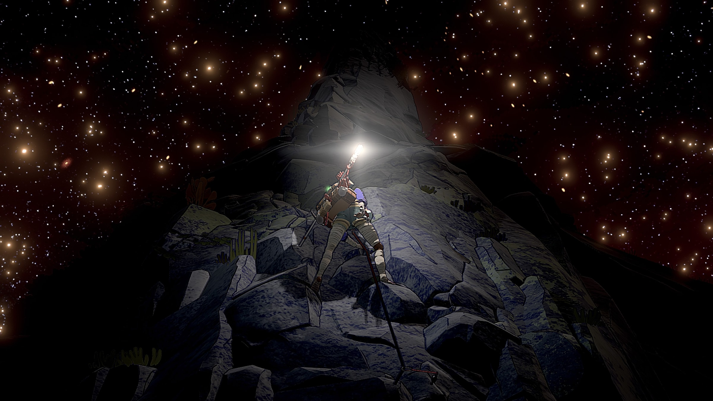
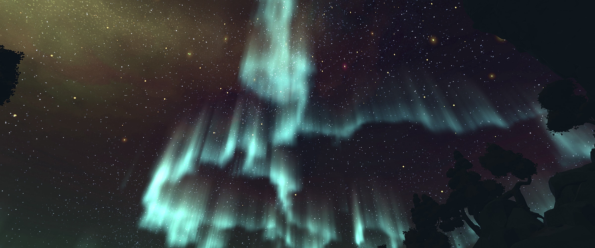
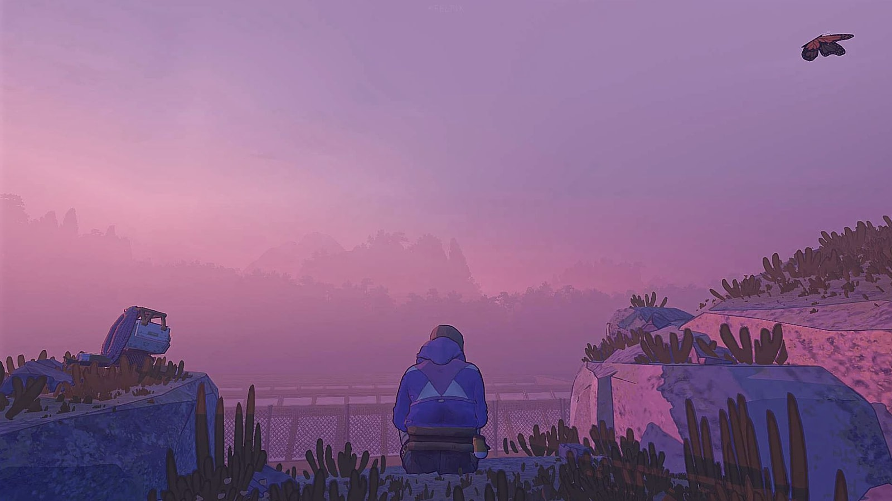

Me cuesta mucho explicar que, para mí, el videojuego es el medio más increíble por el que puedes contar una historia. Que cuando una historia en este medio te pega, te pega como un camión, a un nivel muchísimo más profundo que cualquier película, libro o serie ha hecho conmigo.

La razón principal por la que me cuesta tanto explicarlo es porque… siempre hay alguna mierda que tienes que sobreexplicar tipo *´es que es un juego y esa parte está hecha porque sino un grupo de weones alega porque el juego deja de ser "entretenido"´* o *´mira el 99% de los juegos tienen combate, casi nadie se atreve a hacer juegos sin combate´*. Me pasa con mis juegos favoritos incluso, y me podría llegar a pasar con este si es que decidiese platinarlo. Pero no lo haré, porque la experiencia que me dejó es una que no quiero manchar con gamificaciones como esas.

#### Cuando las mecánicas también te hablan

Cairn no tengo que sobreexplicarlo. Eres una escaladora, tu objetivo es escalar la roca grande, y tal como imaginas, si escalas una montaña te da sed, hambre y frío. Hay un par de cosas más técnicas de escalador profesional, como poner pitones, usar magnesio para tener más agarre, usar las cuerdas para bajar haciendo rápel, y otras cosas más, pero todo se entiende súper rápido.

Justamente esas mecánicas simples son la parte más interesante del juego (por no decir más entretenidas, porque no sé si las catalogaría como entretenida). Y a pesar de eso, no siempre quieres escalar; hay ocasiones en que puedes caminar, demorándote un par de minutos más, y lo vas a preferir por sobre esa "entretención" de escalar, porque a pesar de que tú quieres escalar y Aava, la protagonista, quiere escalar, tú aprendes que es difícil, demandante y que cualquier error se paga caro.

#### Aava no es solo el personaje que controlas

Es súper importante que ese aprendizaje te acerque a entender a la protagonista, porque el primer acercamiento que tienes a ella es un poco duro; Aava es una pesada, es poco comunicativa y está extremadamente obsesionada con ese pedazo de roca gigante. Y aunque lentamente entiendes (un poco) su personalidad, no creo que alcance para empatizar con ella.

Y aún así… no pude evitar sentirme identificado. Porque ella no tiene la respuesta a por qué escala esa montaña, no tiene la respuesta a por qué se obsesiona con ello, ni a por qué se aleja de todas las personas que la quieren y/o necesitan.

Yo tampoco tengo esa respuesta.

Por eso, tal vez, es que no pude hacer más que obsesionarme con ella con llegar hasta el final del viaje. Incluso cuando sabía que no era lo mejor que podía hacer. Incluso cuando se me dieron opciones para hacerlo. Incluso cuando ello significaba solo soledad.

El juego parte diciendo que que solo queremos sentirnos parte de un todo, tocar la eternidad, pero ¿acaso no lo somos ya? ¿Acaso con nuestros amigos, familia, comunidad, no somos parte ya de un todo que deja una marca por toda la eternidad?

Yo sé eso ahora. E igual llevé a Aava hasta el final de esa montaña. Ahí el juego tiene la genialidad de hacerme sentir culpable por ello. ¿O acaso fui yo el que me hice sentir así?

Tampoco tengo la respuesta.

No creo que haya otro juego este año que me haga sentir así.
